# Phân loại màu vật thể bằng mô hình AI

Tài liệu này hướng dẫn cách xây dựng, huấn luyện và triển khai mô hình cây quyết định (Decision Tree) trên Leanbot sử dụng Arduino để phân loại màu vật thể theo thời gian thực dựa trên dữ liệu đo từ cảm biến RGB.

## Mục lục

- [1. Thu thập và chuẩn bị dữ liệu với Leanbot](#1-thu-thập-và-chuẩn-bị-dữ-liệu-với-leanbot)
  + [1.1. Công cụ thu thập dữ liệu trên Leanbot](#11-công-cụ-thu-thập-dữ-liệu-trên-leanbot)
  + [1.2. Thí nghiệm thu thập dữ liệu](#12-thí-nghiệm-thu-thập-dữ-liệu)
  + [1.3. Chuẩn bị dữ liệu](#13-chuẩn-bị-dữ-liệu)
  + [1.4. Dữ liệu ví dụ](#14-dữ-liệu-ví-dụ)
- [2. Xây dựng mô hình bằng Python](#2-xây-dựng-mô-hình-bằng-python)
  + [2.1. Chia dữ liệu (huấn luyện và kiểm tra)](#21-chia-dữ-liệu-huấn-luyện-và-kiểm-tra)
  + [2.2. Huấn luyện mô hình](#22-huấn-luyện-mô-hình)
  + [2.3. Đánh giá / kiểm tra mô hình](#23-đánh-giá--kiểm-tra-mô-hình)
  + [2.4. Mô hình ví dụ](#24-mô-hình-ví-dụ)
- [3. Triển khai mô hình trên Leanbot](#3-triển-khai-mô-hình-trên-leanbot)
  + [3.1. Chuyển mô hình thành mã Leanbot bằng AI tạo sinh](#31-chuyển-mô-hình-thành-mã-leanbot-bằng-ai-tạo-sinh)
  + [3.2. Tích hợp vào chương trình Leanbot](#32-tích-hợp-vào-chương-trình-leanbot)
  + [3.3. Chạy trên Leanbot](#33-chạy-trên-leanbot)

---

## 1. Thu thập và chuẩn bị dữ liệu với Leanbot

### 1.1. Công cụ thu thập dữ liệu trên Leanbot

Mã nguồn sau được sử dụng trên Leanbot để đo ánh sáng RGB phản xạ từ một vật thể và xuất dữ liệu thô dưới dạng JSON qua cổng Serial.
- Mã thu thập dữ liệu ví dụ: [samplingColor.ino](Code/samplingColor.ino)

#### Tùy chỉnh: Nhãn và cấu hình màu

Để xác định các màu cần lấy mẫu, hãy chỉnh sửa những biến quan trọng sau trong mã nguồn:
- `objColorNum`: Tổng số màu cần đo.
- `objColor[]`: Tên các màu, đồng thời xác định thứ tự Leanbot thu thập dữ liệu.
- `objColorRGB[]`: Các giá trị RGB ứng với từng màu mà Leanbot sẽ hiển thị trên LED.
- `objColorIndex`: Theo dõi chỉ số màu đang được đo.

```C 
#define objColorNum    5
const char* objColor[objColorNum] = {"RED", "YELLOW", "GREEN", "BLUE", "PURPLE"}; 
const uint32_t objColorNum[objColorNum] = {0xFF0000, 0xFFFF00, 0x00FF00,0x0000FF, 0xFF00FF};
int objColorIndex = 0;
```

Cách thay đổi các màu:
- Để dùng những màu khác hoặc thay đổi thứ tự, hãy chỉnh sửa mảng `objColor[]`.
- Cập nhật mảng `objColorRGB[]` bằng các giá trị RGB tương ứng.
- Điều chỉnh `objColorNum` cho khớp với tổng số màu cậu muốn thu thập.
- Bằng cách này, cậu có thể tùy chỉnh tập màu cần lấy dữ liệu mà không cần thay đổi logic chính của chương trình.

#### Cách sử dụng

**Các bước:**
<ol>
  <li>Bật nguồn Leanbot và kết nối robot với máy tính qua USB.</li>
  <li>Mở Serial Monitor.</li>
  <li>Khi bắt đầu, <code>objColor</code> có giá trị YELLOW. Đặt một vật màu vàng (ví dụ khối Jenga màu vàng) phía trước Leanbot, giữa hai càng gắp, trong phạm vi 5 cm.</li>
  <li>Nhấn nút TB2A: Leanbot nhấp nháy LED RGB và đo màu của vật thể.
    <ul>
      <li>Ở mỗi lần đo, hãy đặt vật thể với một chút thay đổi (khoảng cách, góc xoay, độ lệch nhỏ giữa hai càng gắp) để tạo ra sự biến thiên ngẫu nhiên tự nhiên.</li>
    </ul>
  </li>
  <li>Leanbot in dữ liệu JSON sau lên Serial Monitor:
    <pre>{
  "objColor": "YELLOW",
  "objRed": 17,
  "objGreen": 20,
  "objBlue": 4
}</pre>
  </li>
  <li>Nhấn nút nhiều lần (ví dụ 20 lần): còi phát tiếng bíp và chương trình chuyển sang màu kế tiếp (GREEN).</li>
  <li>Đặt một vật thể có màu tương ứng với màu mới được chọn, lặp lại các phép đo, rồi tiếp tục lần lượt với BLUE, PURPLE và RED.</li>
  <li>Sau RED, chu trình lặp lại từ YELLOW. Như vậy một chu kỳ lấy mẫu đầy đủ đã hoàn thành và dữ liệu có thể được lưu thành tệp JSON.</li>
</ol>

#### Lưu dữ liệu vào tệp JSON

**Lưu dữ liệu vào tệp JSON**
1. Sao chép toàn bộ nội dung từ Serial Monitor vào một tệp văn bản.  
2. Thêm dấu `[` vào đầu tệp và dấu `]` vào cuối tệp.  
3. Lưu tệp ở định dạng JSON (`.json`).  

> Ví dụ: dữ liệu gốc sao chép từ Serial Monitor

```
AT+NAME
LB639199                            <- Replace this line with "["
{
"objColor":"YELLOW",
"objRed":17,
"objGreen":20,
"objBlue":4,
},
{
"objColor":"YELLOW",
"objRed":9,
"objGreen":11,
"objBlue":2,
},

...

{
"objColor":"RED",
"objRed":6,
"objGreen":0,
"objBlue":1,
},
{
"objColor":"RED",
"objRed":14,
"objGreen":1,
"objBlue":1,
},                                <- Replace "," with "]"     
```

> Sau khi chỉnh sửa (tệp JSON hợp lệ): [Tệp JSON ví dụ](Data/Indoor%20with%20Normal%20Lighting%203.json)

```
[
{
"objColor":"YELLOW",
"objRed":17,
"objGreen":20,
"objBlue":4,
},
{
"objColor":"YELLOW",
"objRed":9,
"objGreen":11,
"objBlue":2,
},

...

{
"objColor":"RED",
"objRed":6,
"objGreen":0,
"objBlue":1,
},
{
"objColor":"RED",
"objRed":14,
"objGreen":1,
"objBlue":1,
}]    
```

### 1.2. Thí nghiệm thu thập dữ liệu

#### Các điều kiện khác nhau

- **Địa điểm**: Trong nhà, ngoài trời.
- **Điều kiện chiếu sáng**: Ánh sáng bình thường, ánh sáng bị che khuất, ánh sáng mạnh, ánh sáng chiếu trực tiếp.

#### Mẹo thu thập dữ liệu

Khi thu thập mẫu, hãy cố gắng bao phủ các điều kiện thực tế đa dạng và có sự thay đổi:
- Thay đổi vị trí vật thể, góc xoay và độ lệch nhẹ để tạo ra sự biến thiên ngẫu nhiên tự nhiên.
- Giữ vật thể ở khoảng cách ngắn (ví dụ trong khoảng 5–8 cm).  
- Bề mặt vật thể: đo các mặt khác nhau của khối gỗ.  
- Hướng vật thể: xoay vật thể ở những góc khác nhau.  
- Thay đổi vị trí: điều chỉnh khoảng cách và cho phép lệch nhẹ khỏi trục giữa.
- Sử dụng nhiều vật thể có cùng màu.

#### Hình ảnh ví dụ về cách đặt vật thể

> Bố trí thí nghiệm thu thập dữ liệu RGB bằng Leanbot:

<p style="text-align: center;">  
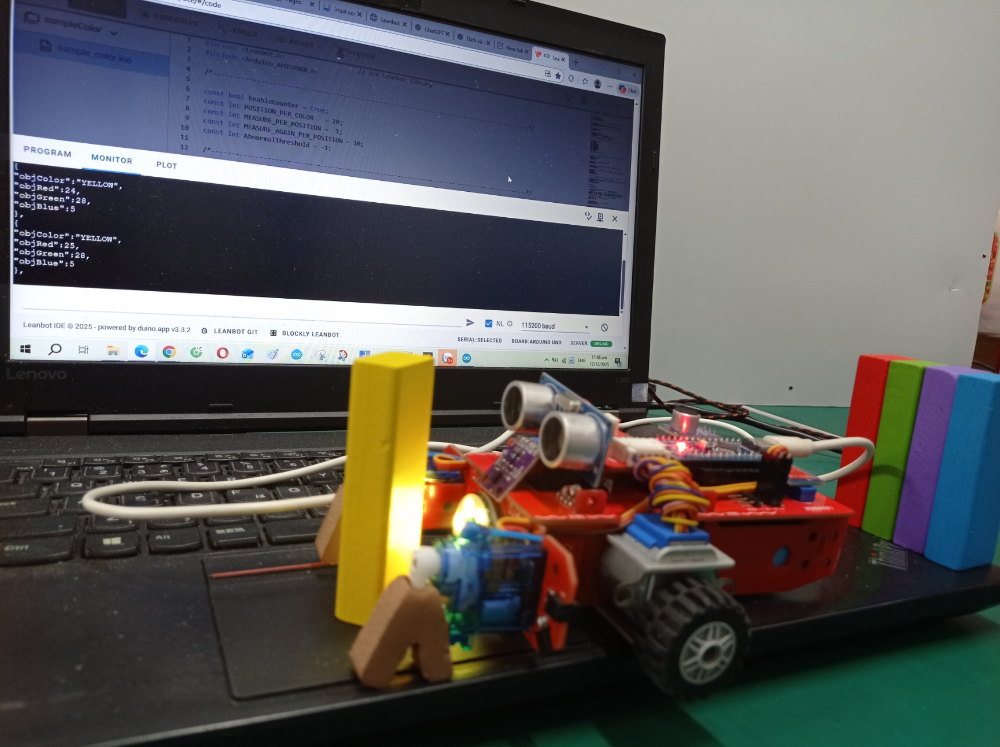
</p>

> Vật màu đỏ được đặt trước Leanbot khi LED RGB có màu **RED**.

<p style="text-align: center;">  
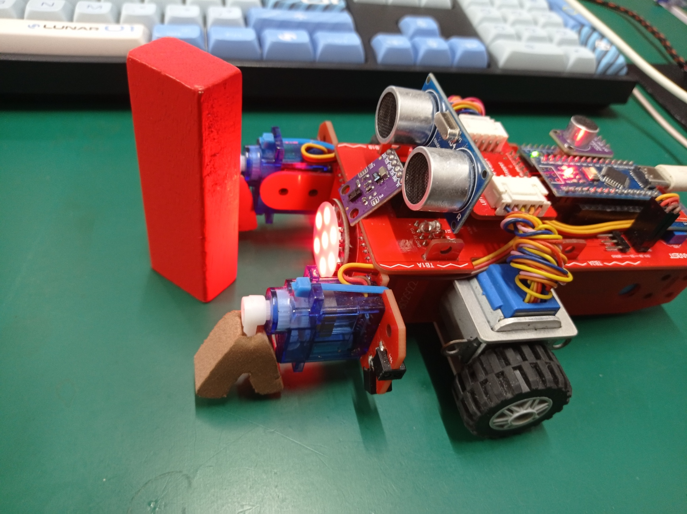
</p>

> Vật màu xanh lá được đặt trước Leanbot khi LED RGB có màu **GREEN**.

<p style="text-align: center;">  
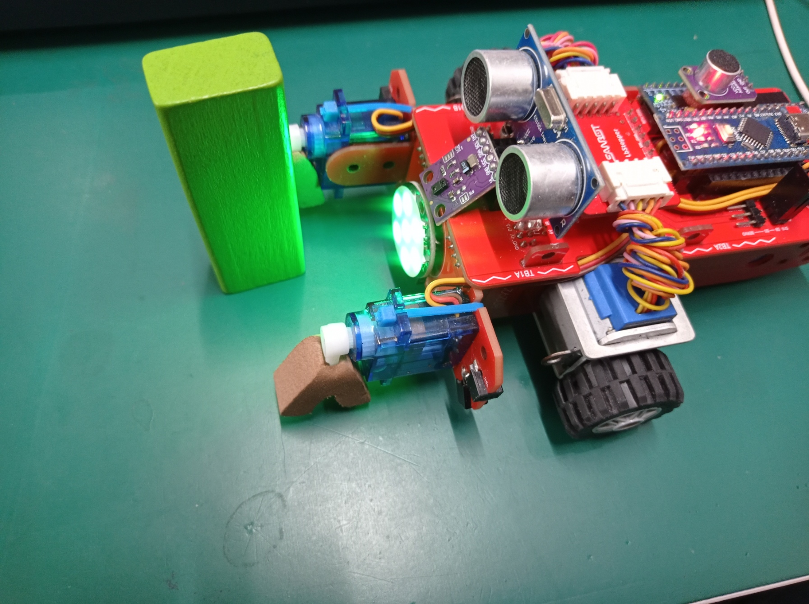
</p>

> Vật màu xanh dương được đặt trước Leanbot khi LED RGB có màu **BLUE**.

<p style="text-align: center;">  
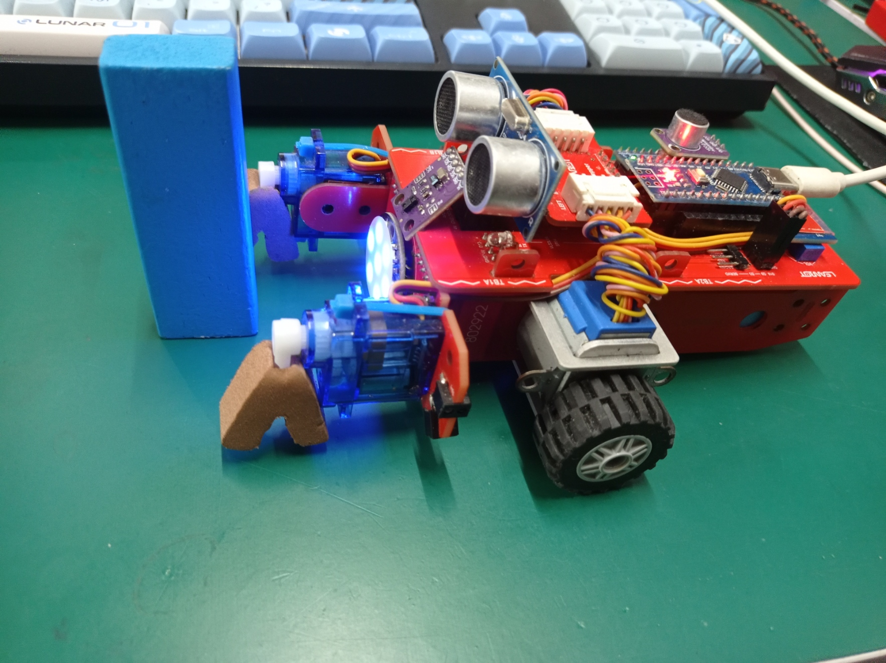
</p>


> Vật màu vàng được đặt trước Leanbot khi LED RGB có màu **YELLOW**.

<p style="text-align: center;">  
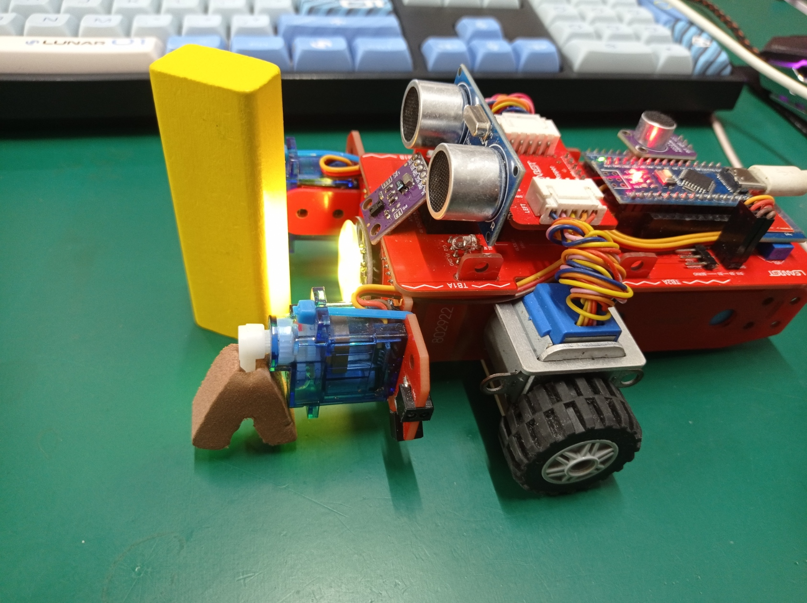
</p>


> Vật màu tím được đặt trước Leanbot khi LED RGB có màu **PURPLE**.

<p style="text-align: center;">  
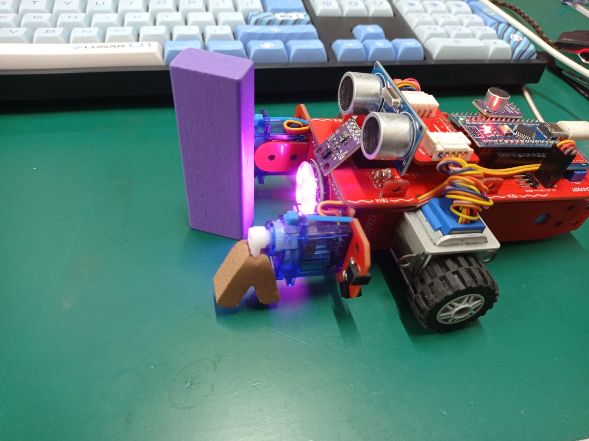
</p>

#### 1.3. Chuẩn bị dữ liệu

- Lặp lại quy trình thu thập dữ liệu được mô tả ở trên nhiều lần (một lượt thu thập tương ứng với một chu kỳ lấy mẫu đầy đủ của chương trình).  
- Mỗi lượt thu thập tạo ra một tệp JSON phục vụ huấn luyện.  
- Thu thập nhiều mẫu hơn giúp cây quyết định xử lý nhiễu và phân biệt các màu tương tự nhau.  

#### 1.4. Dữ liệu ví dụ

Trong tài liệu này có ba tệp dữ liệu mẫu làm ví dụ (khuyến khích sinh viên thu thập thêm để có kết quả tốt hơn):  

| Tệp JSON | Số mẫu | Số màu | Địa điểm | Điều kiện chiếu sáng | Thời gian thu thập (phút) |
| :---- | :----: | :----: | :----: | :----: | :----: |
| [Indoor with Normal Lighting 1.json](Data/Indoor%20with%20Normal%20Lighting%201.json) | 100 | 5 | Trong nhà | Bình thường | 3 |
| [Indoor with Normal Lighting 2.json](Data/Indoor%20with%20Normal%20Lighting%202.json) | 100 | 5 | Trong nhà | Bình thường | 3 |
| [Indoor with Normal Lighting 3.json](Data/Indoor%20with%20Normal%20Lighting%203.json) | 100 | 5 | Trong nhà | Bình thường | 3 |

## 2. Xây dựng mô hình bằng Python

### 2.1. Chia dữ liệu (huấn luyện và kiểm tra)

Phần này giải thích cách chuẩn bị tập dữ liệu huấn luyện và kiểm tra từ các tệp JSON mẫu.
- Đảm bảo đã tải tất cả các tệp JSON thu thập được lên không gian làm việc PNote trước khi chạy mã.
- Hướng dẫn cơ bản: https://www.w3schools.com/python/python_ml_train_test.asp
- Tài liệu tham khảo `train_test_split`: https://scikit-learn.org/stable/modules/generated/sklearn.model_selection.train_test_split.html

#### Chuẩn bị tập huấn luyện và tập kiểm tra

Hàm dưới đây đọc tất cả các tệp JSON, làm sạch những mẫu không hợp lệ, rồi chia dữ liệu thành tập huấn luyện và tập kiểm tra:

```python
def CreateTrainTestData(train_pct=0.8):
    # Load all JSON files
    df = pd.concat(
        [pd.read_json(f, orient="records") for f in glob.glob(f"*.json")],
        ignore_index=True
    )

    # Remove samples with any negative RGB value (invalid samples)
    df = df[~(
        (df['objRed'] < 0) |
        (df['objGreen'] < 0) |
        (df['objBlue'] < 0)
    )]

    # Features and labels
    X = df[['objRed', 'objGreen', 'objBlue']]
    y = df['objColor']

    # Stratified train/test split
    X_train, X_test, y_train, y_test = train_test_split(
        X, y,
        train_size=train_pct,
        stratify=y,       # <- keep color proportions
		random_state=13,  # <- for reproducible
    )

    # Merge X and y back for convenience
    train = X_train.copy()
    train['objColor'] = y_train

    test = X_test.copy()
    test['objColor'] = y_test

    return train, test
```

**Chức năng:**
- Đọc tất cả tệp `.json` trong thư mục PNote hiện tại (ví dụ: ba tệp dữ liệu mẫu đã tải lên trước đó).  
- Gộp chúng thành một tập dữ liệu duy nhất.  
- Loại bỏ các mẫu không hợp lệ có giá trị RGB âm.  
- Sử dụng các giá trị RGB làm đặc trưng đầu vào và `objColor` làm nhãn.  
- Chia dữ liệu thành tập huấn luyện và tập kiểm tra, đồng thời duy trì tỷ lệ các lớp màu ở mức cân bằng.
- Lưu ý về random_state:
  + `random_state` chỉ được dùng để đảm bảo việc chia tập huấn luyện/kiểm tra có thể tái lập.
  + Khi dùng cùng một `random_state`, cậu sẽ luôn nhận được cùng cách chia dữ liệu, hữu ích cho gỡ lỗi và lập tài liệu.
  + Có thể bỏ tham số này hoặc đặt thành `None` để mỗi lần chia thực sự ngẫu nhiên.

**Cách sử dụng:**
- `train_pct`: tỷ lệ dữ liệu dùng để huấn luyện (mặc định: 80%).
- `train`: tập dữ liệu huấn luyện.
- `test`: tập dữ liệu kiểm tra.

Cách này tạo ra dữ liệu sạch, cân bằng để huấn luyện và đánh giá cây quyết định.

```python
train, test = CreateTrainTestData(train_pct=0.8)
```

#### Kiểm tra thông tin tập dữ liệu

Hàm dưới đây in thông tin cơ bản về tập dữ liệu, bao gồm tổng số mẫu và phân bố các màu.

```Python
def printDataInfo(df,dataSetLabel):
    print(f"\nDataset {dataSetLabel} Info:\n")
    print(f"Total Number of Samples: {len(df)}")
    print(df['objColor'].value_counts())
```

**Các thông tin hiển thị:**
- Tổng số mẫu đã thu thập.  
- Số mẫu thuộc từng lớp màu.

**Cách sử dụng:**

```python
printDataInfo(train, "Train")
printDataInfo(test, "Test")
```

**Kết quả:**

```
Dataset Train Info:

Total Number of Samples: 239
objColor
BLUE      48
GREEN     48
RED       48
PURPLE    48
YELLOW    47
Name: count, dtype: int64

Dataset Test Info:

Total Number of Samples: 60
objColor
BLUE      12
PURPLE    12
GREEN     12
YELLOW    12
RED       12
Name: count, dtype: int64
```

Diễn giải:
- Tập dữ liệu huấn luyện và kiểm tra đã được tạo thành công.
- Các lớp màu được phân bố đều trong cả hai tập.
- Điều này xác nhận cách chia dữ liệu cân bằng và phù hợp để huấn luyện, đánh giá.

### 2.2. Huấn luyện mô hình

Phần này trình bày cách huấn luyện mô hình cây quyết định bằng tập dữ liệu huấn luyện đã chuẩn bị.
Quy trình gồm:
- Huấn luyện cây quyết định bằng tập huấn luyện đã chuẩn bị.
- Dự đoán nhãn màu cho tập kiểm tra.
- Đánh giá mô hình bằng ma trận nhầm lẫn đã chuẩn hóa.
- Trực quan hóa các luật quyết định đã học.
- Tham khảo: https://www.w3schools.com/python/python_ml_decision_tree.asp

Một ví dụ hoàn chỉnh về huấn luyện, kiểm tra và đánh giá cây quyết định trên bộ dữ liệu được tạo ở phần trước có tại đây:
- **Mã ví dụ:** [dtree.py](Code/dtree.py)

#### Xác định đặc trưng và nhãn

Mô hình cây quyết định được huấn luyện với các giá trị RGB (`objRed`, `objGreen`, `objBlue`) làm đặc trưng đầu vào và `objColor` làm nhãn đích.

Ở đây, các tập dữ liệu huấn luyện và kiểm tra được tạo ở phần trước sẽ được tách thành các đặc trưng (X) và nhãn (y):
- `X_train, X_test`: các giá trị RGB được dùng làm đầu vào mô hình.
- `y_train, y_test`: nhãn màu đúng (ground truth).

```Python 
X_train = Train[['objRed', 'objGreen', 'objBlue']]
y_train = Train['objColor']
 
X_test = Test[['objRed', 'objGreen', 'objBlue']]
y_test = Test['objColor']
```

#### Huấn luyện cây quyết định

Hàm dưới đây tạo và huấn luyện bộ phân loại cây quyết định:
- `DecisionTreeClassifier(...)`: tạo một mô hình cây quyết định bằng scikit-learn.
- `max_depth=5`: giới hạn số mức độ sâu mà cây có thể phát triển.
  + Giữ cho mô hình nhỏ gọn và dễ hiểu.
  + Tránh cây quá phức tạp do nhiễu.
- `.fit(X_train, y_train)`: huấn luyện mô hình bằng:
  + `X_train`: các giá trị đặc trưng RGB.
  + `y_train`: các nhãn màu tương ứng.

```Python
def dtree(X_train, y_train):
 
    ## Decision Tree Training
    ## Reference: https://www.w3schools.com/python/python_ml_decision_tree.asp
 
    # Initialize and train the decision tree classifier
    dtree = DecisionTreeClassifier(max_depth=5)
    dtree = dtree.fit(X_train.values, y_train)
    return dtree
```

Sau khi định nghĩa hàm, chỉ cần một dòng lệnh để huấn luyện mô hình:

```python
dtree_model = dtree(X_train, y_train)
```

### 2.3. Đánh giá / kiểm tra mô hình

#### Kiểm tra mô hình đã huấn luyện

Sau khi huấn luyện, cây quyết định được kiểm tra bằng tập dữ liệu kiểm tra:
- `X_test` chứa các giá trị RGB không được sử dụng trong quá trình huấn luyện.
- `.predict(...)` áp dụng cây quyết định đã huấn luyện lên các đầu vào RGB này.
- `predict_objColor` lưu các nhãn màu được dự đoán cho mỗi mẫu kiểm tra.

```python 
# Use the trained decision tree model to predict the color based on RGB values in the test set
predict_objColor = dtree_model.predict(X_test.values)
```

Sau đó, các dự đoán được so sánh với nhãn thực (y_test) bằng ma trận nhầm lẫn để đánh giá hiệu năng mô hình.

#### Đánh giá mô hình: Ma trận nhầm lẫn

Ma trận nhầm lẫn thể hiện mức độ chính xác của mô hình khi dự đoán từng lớp màu.
- Đây là một ma trận **N × N**, trong đó:
  - **Các cột** biểu thị nhãn thực.
  - **Các hàng** biểu thị nhãn dự đoán.
- Mỗi ô *(i, j)* cho biết có bao nhiêu mẫu thuộc lớp *j* được dự đoán thành lớp *i*.
- Trong tài liệu này, ma trận được **chuẩn hóa theo hàng**, nghĩa là:
  - Tổng các giá trị trên mỗi hàng bằng 1.
  - Mỗi giá trị biểu thị tỷ lệ dự đoán cho một lớp thực tương ứng.

Sử dụng hàm dưới đây để tính toán và trực quan hóa ma trận nhầm lẫn:

```
def confusion_matrix_display(predict_objColor, actual_objColor, labels):
    # Compute a normalized confusion matrix (values between 0 and 1)
    confusion_matrix = metrics.confusion_matrix(y_pred=predict_objColor, y_true=actual_objColor,normalize='true')
    # Create the display object with label names
    cm_display = metrics.ConfusionMatrixDisplay(confusion_matrix = confusion_matrix, display_labels = labels)
    # Print the numeric matrix to the console
    print("Normalized Confusion Matrix:\n", confusion_matrix)       
    # Plot the confusion matrix with better visual formatting
    plt.figure()
    cm_display.plot()
    plt.xticks(rotation=45,ha="right",rotation_mode="anchor") # Rotate x-axis labels for readability
    plt.show()
```

**Cách sử dụng:**

```Python 
# Use the class labels ("dtree_model.classes_") from the trained model for display in the confusion matrix
confusion_matrix_display(predict_objColor,actual_objColor,dtree_model.classes_)
```

> Ví dụ: biểu đồ ma trận nhầm lẫn của tập kiểm tra

<p style="text-align: center;">  
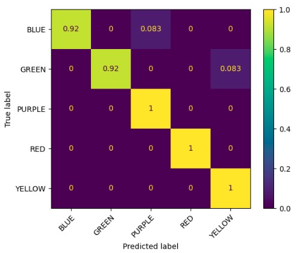
</p>

> Ví dụ: ma trận nhầm lẫn của tập kiểm tra dưới dạng văn bản:

```
Normalized Confusion Matrix:
 [[0.91666667 0.         0.08333333 0.         0.        ]
 [0.         0.91666667 0.         0.         0.08333333]
 [0.         0.         1.         0.         0.        ]
 [0.         0.         0.         1.         0.        ]
 [0.         0.         0.         0.         1.        ]]
```

Diễn giải ma trận:
- **Các vật màu BLUE**:  
  + Khoảng 92% mẫu được dự đoán đúng là **BLUE**.  
  + Khoảng 8,3% bị phân loại nhầm thành **PURPLE**.
- **Các vật màu GREEN**:  
  + Khoảng 92% mẫu được dự đoán đúng là **GREEN**.  
  + Khoảng 8,3% bị phân loại nhầm thành **YELLOW**.
- **Các vật màu PURPLE, RED và YELLOW**:  
  + 100% số mẫu được phân loại chính xác, không có dự đoán sai.

### 2.4. Mô hình ví dụ

Để hiểu cây quyết định đã huấn luyện đưa ra quyết định như thế nào, ta có thể trực quan hóa cây dưới dạng đồ họa hoặc các luật dưới dạng văn bản.
- Các ví dụ này được lấy trực tiếp từ mô hình huấn luyện trên tập dữ liệu RGB đã thu thập.

#### Trực quan hóa bằng đồ họa

Đoạn mã sau tạo một ảnh minh họa:
- Các điểm phân chia theo đặc trưng RGB tại từng nút của cây quyết định.  
- Những đường đi quyết định mà mô hình dùng để phân loại các màu.  

```Python 
# Plotting the decision tree
plt.figure(figsize=(50, 30))  # Set the figure size (in inches)
tree.plot_tree(dtree_model, feature_names=['objRed', 'objGreen', 'objBlue'], fontsize=10)  # Draw the tree with feature names
plt.savefig("dtree.jpg")  # Save the tree diagram as an image
```

> Ví dụ: biểu đồ của cây quyết định đã huấn luyện trên bộ dữ liệu của chúng ta:

<p style="text-align: center;">  
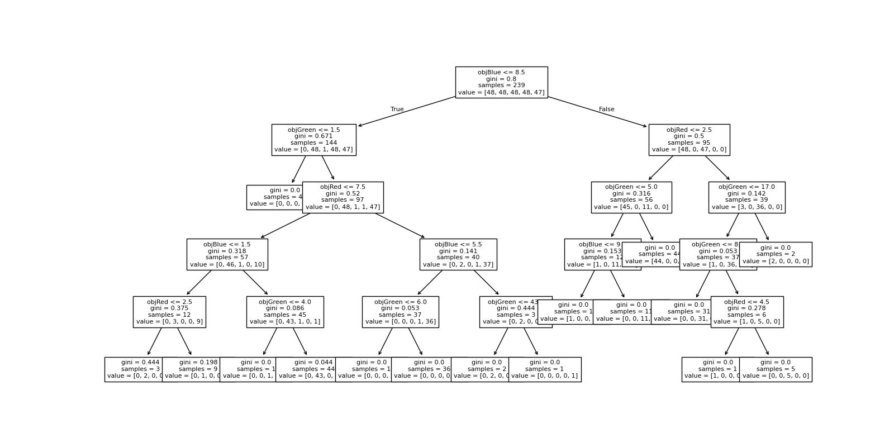
</p>

#### Các luật dưới dạng văn bản

Ta cũng có thể xuất cây quyết định thành các luật dễ đọc đối với con người.
- Các luật này phản ánh những ngưỡng thực tế mà mô hình đã học từ tập dữ liệu:

```Python 
rules = export_text(
    dtree_model,
    feature_names=['objRed', 'objGreen', 'objBlue']
)

print('\n' + rules + '\n')
```

> Ví dụ: các luật được tạo từ cây quyết định đã huấn luyện trên tập dữ liệu của chúng ta:

```
|--- objBlue <= 8.50
|   |--- objGreen <= 1.50
|   |   |--- class: RED
|   |--- objGreen >  1.50
|   |   |--- objRed <= 7.50
|   |   |   |--- objBlue <= 1.50
|   |   |   |   |--- objRed <= 2.50
|   |   |   |   |   |--- class: GREEN
|   |   |   |   |--- objRed >  2.50
|   |   |   |   |   |--- class: YELLOW
|   |   |   |--- objBlue >  1.50
|   |   |   |   |--- objGreen <= 4.00
|   |   |   |   |   |--- class: PURPLE
|   |   |   |   |--- objGreen >  4.00
|   |   |   |   |   |--- class: GREEN
|   |   |--- objRed >  7.50
|   |   |   |--- objBlue <= 5.50
|   |   |   |   |--- objGreen <= 6.00
|   |   |   |   |   |--- class: RED
|   |   |   |   |--- objGreen >  6.00
|   |   |   |   |   |--- class: YELLOW
|   |   |   |--- objBlue >  5.50
|   |   |   |   |--- objGreen <= 43.00
|   |   |   |   |   |--- class: GREEN
|   |   |   |   |--- objGreen >  43.00
|   |   |   |   |   |--- class: YELLOW
|--- objBlue >  8.50
|   |--- objRed <= 2.50
|   |   |--- objGreen <= 5.00
|   |   |   |--- objBlue <= 9.50
|   |   |   |   |--- class: BLUE
|   |   |   |--- objBlue >  9.50
|   |   |   |   |--- class: PURPLE
|   |   |--- objGreen >  5.00
|   |   |   |--- class: BLUE
|   |--- objRed >  2.50
|   |   |--- objGreen <= 17.00
|   |   |   |--- objGreen <= 8.50
|   |   |   |   |--- class: PURPLE
|   |   |   |--- objGreen >  8.50
|   |   |   |   |--- objRed <= 4.50
|   |   |   |   |   |--- class: BLUE
|   |   |   |   |--- objRed >  4.50
|   |   |   |   |   |--- class: PURPLE
|   |   |--- objGreen >  17.00
|   |   |   |--- class: BLUE
```

## 3. Triển khai mô hình

Chương này trình bày cách triển khai cây quyết định đã huấn luyện trên Leanbot. Quy trình tập trung sử dụng trợ lý AI (ChatGPT, Gemini, v.v.) để chuyển mô hình đã huấn luyện thành mã C++ nhúng rồi kiểm thử bằng các vật thể thực tế.

### 3.1. Chuyển mô hình thành mã Leanbot bằng AI tạo sinh

Chúng ta sử dụng trợ lý AI để chuyển các luật cây quyết định đã xuất thành một hàm phân loại được viết bằng tay cho Arduino.

#### Quy trình được đề xuất

1. **Huấn luyện cây quyết định bằng Python**
   - Sử dụng `export_text()` để lấy cây dưới dạng luật (đã giới thiệu ở trên).

2. **Sao chép các luật của cây**
   - Dán trực tiếp phần đầu ra dạng văn bản vào ChatGPT / Gemini.

3. **Yêu cầu AI tạo hàm**
   - Yêu cầu một hàm, ví dụ:
     - `classifyColor(int r, int g, int b)`
   - Hàm trả về một chuỗi là tên của màu.
   - Chỉ rõ:
     - Ngôn ngữ đích (C / Arduino).
     - Chỉ sử dụng đầu vào số nguyên (không dùng số thực nếu muốn).

#### Các bước tạo hàm phân loại kiểu C bằng AI

</ol>

<li value="1" style="list-style-type: none;"> 1. Mở ChatGPT hoặc Gemini.</li>
<li value="2" style="list-style-type: none;"> 2. Sao chép cây quyết định dưới dạng văn bản (từ mô hình đã huấn luyện) rồi dán vào ChatGPT / Gemini.</li>

<p style="text-align: center;">  
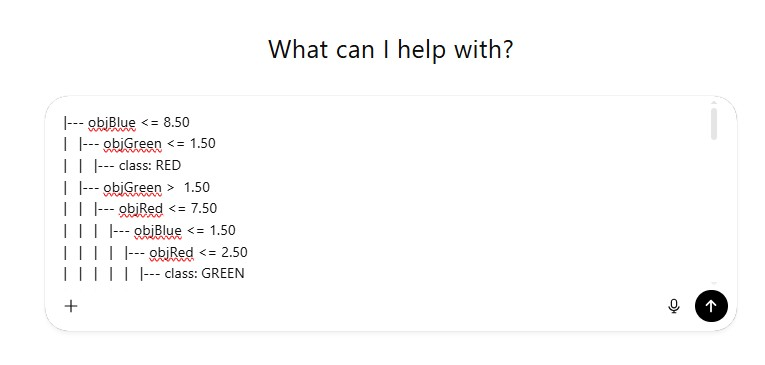
</p>


<li value="3" style="list-style-type: none;"> 3. Yêu cầu AI tạo hàm (sử dụng các ngưỡng số thực) bằng lời nhắc sau:</li>

```Text
Convert the following decision tree into C code using nested if–else statements.
Output only a function with this exact signature and style: String classifyColor(float objRed, float objGreen, float objBlue)
```

=> AI sẽ tạo ra một hàm theo cú pháp C tương tự như sau:

```C
String classifyColor(float objRed, float objGreen, float objBlue) {
    // --- objBlue <= 8.50
    if (objBlue <= 8.50) {
        // |--- objGreen <= 1.50
        if (objGreen <= 1.50) {
            // |   |--- class: RED
            return "RED";
        }
        // |--- objGreen > 1.50
        else {
            // |   |--- objRed <= 7.50
            if (objRed <= 7.50) {
                // |   |   |--- objBlue <= 1.50
                if (objBlue <= 1.50) {
                    // |   |   |   |--- objRed <= 2.50
                    if (objRed <= 2.50) {
                        // |   |   |   |   |--- class: GREEN
                        return "GREEN";
                    }
                    // |   |   |   |--- objRed > 2.50
                    else {
                        // |   |   |   |   |--- class: YELLOW
                        return "YELLOW";
                    }
                }
                // |   |   |--- objBlue > 1.50
                else {
                    // |   |   |   |--- objGreen <= 4.00
                    if (objGreen <= 4.00) {
                        // |   |   |   |   |--- class: PURPLE
                        return "PURPLE";
                    }
                    // |   |   |   |--- objGreen > 4.00
                    else {
                        // |   |   |   |   |--- class: GREEN
                        return "GREEN";
                    }
                }
            }
            // |   |--- objRed > 7.50
            else {
                // |   |   |--- objBlue <= 5.50
                if (objBlue <= 5.50) {
                    // |   |   |   |--- objGreen <= 6.00
                    if (objGreen <= 6.00) {
                        // |   |   |   |   |--- class: RED
                        return "RED";
                    }
                    // |   |   |   |--- objGreen > 6.00
                    else {
                        // |   |   |   |   |--- class: YELLOW
                        return "YELLOW";
                    }
                }
                // |   |   |--- objBlue > 5.50
                else {
                    // |   |   |   |--- objGreen <= 43.00
                    if (objGreen <= 43.00) {
                        // |   |   |   |   |--- class: GREEN
                        return "GREEN";
                    }
                    // |   |   |   |--- objGreen > 43.00
                    else {
                        // |   |   |   |   |--- class: YELLOW
                        return "YELLOW";
                    }
                }
            }
        }
    }
    // --- objBlue > 8.50
    else {
        // |--- objRed <= 2.50
        if (objRed <= 2.50) {
            // |   |--- objGreen <= 5.00
            if (objGreen <= 5.00) {
                // |   |   |--- objBlue <= 9.50
                if (objBlue <= 9.50) {
                    // |   |   |   |--- class: BLUE
                    return "BLUE";
                }
                // |   |   |--- objBlue > 9.50
                else {
                    // |   |   |   |--- class: PURPLE
                    return "PURPLE";
                }
            }
            // |   |--- objGreen > 5.00
            else {
                // |   |   |--- class: BLUE
                return "BLUE";
            }
        }
        // |--- objRed > 2.50
        else {
            // |   |--- objGreen <= 17.00
            if (objGreen <= 17.00) {
                // |   |   |--- objGreen <= 8.50
                if (objGreen <= 8.50) {
                    // |   |   |   |--- class: PURPLE
                    return "PURPLE";
                }
                // |   |   |--- objGreen > 8.50
                else {
                    // |   |   |   |--- objRed <= 4.50
                    if (objRed <= 4.50) {
                        // |   |   |   |   |--- class: BLUE
                        return "BLUE";
                    }
                    // |   |   |   |--- objRed > 4.50
                    else {
                        // |   |   |   |   |--- class: PURPLE
                        return "PURPLE";
                    }
                }
            }
            // |   |--- objGreen > 17.00
            else {
                // |   |   |--- class: BLUE
                return "BLUE";
            }
        }
    }
}
```

<li value="4" style="list-style-type: none;"> 4. Yêu cầu AI tạo hàm (sử dụng ngưỡng số nguyên) bằng lời nhắc sau:</li>

</ol>


```Text
Convert the decision tree directly into C code using integer comparisons only.
Assume objRed, objGreen, objBlue are integers.

Output only a function with this exact signature and style: String classifyColor(int objRed, int objGreen, int objBlue)

Rules:
DO NOT generate a float version first
DO NOT use floats, casts, rounding, ceil, or floor
Replace thresholds like <= 8.50 with the correct integer-safe condition
(e.g. <= 8.50 → <= 8, > 8.50 → >= 9)
Skip or collapse branches that become unreachable or redundant for integers
Preserve the exact logical intent of the original tree
Use clear nested if / else with comments showing the resolved integer condition
Return only: "RED", "GREEN", "BLUE", "YELLOW", "PURPLE"
No extra code
```

=> AI sẽ tạo ra một hàm theo cú pháp C tương tự như sau:

```C 
String classifyColor(int objRed, int objGreen, int objBlue) {
    // Original: --- objBlue <= 8.50  | Integer: if (objBlue <= 8)
    if (objBlue <= 8) {
        // Original: |--- objGreen <= 1.50 | Integer: if (objGreen <= 1)
        if (objGreen <= 1) {
            // |   |--- class: RED
            return "RED";
        }
        // Original: |--- objGreen > 1.50 | Integer: else (objGreen >= 2)
        else {
            // Original: |   |--- objRed <= 7.50 | Integer: if (objRed <= 7)
            if (objRed <= 7) {
                // Original: |   |   |--- objBlue <= 1.50 | Integer: if (objBlue <= 1)
                if (objBlue <= 1) {
                    // Original: |   |   |   |--- objRed <= 2.50 | Integer: if (objRed <= 2)
                    if (objRed <= 2) {
                        // |   |   |   |   |--- class: GREEN
                        return "GREEN";
                    }
                    // Original: |   |   |   |--- objRed > 2.50 | Integer: else (objRed >= 3)
                    else {
                        // |   |   |   |   |--- class: YELLOW
                        return "YELLOW";
                    }
                }
                // Original: |   |   |--- objBlue > 1.50 | Integer: else (objBlue >= 2)
                else {
                    // Original: |   |   |   |--- objGreen <= 4.00 | Integer: if (objGreen <= 4)
                    if (objGreen <= 4) {
                        // |   |   |   |   |--- class: PURPLE
                        return "PURPLE";
                    }
                    // Original: |   |   |   |--- objGreen > 4.00 | Integer: else (objGreen >= 5)
                    else {
                        // |   |   |   |   |--- class: GREEN
                        return "GREEN";
                    }
                }
            }
            // Original: |   |--- objRed > 7.50 | Integer: else (objRed >= 8)
            else {
                // Original: |   |   |--- objBlue <= 5.50 | Integer: if (objBlue <= 5)
                if (objBlue <= 5) {
                    // Original: |   |   |   |--- objGreen <= 6.00 | Integer: if (objGreen <= 6)
                    if (objGreen <= 6) {
                        // |   |   |   |   |--- class: RED
                        return "RED";
                    }
                    // Original: |   |   |   |--- objGreen > 6.00 | Integer: else (objGreen >= 7)
                    else {
                        // |   |   |   |   |--- class: YELLOW
                        return "YELLOW";
                    }
                }
                // Original: |   |   |--- objBlue > 5.50 | Integer: else (objBlue >= 6)
                else {
                    // Original: |   |   |   |--- objGreen <= 43.00 | Integer: if (objGreen <= 43)
                    if (objGreen <= 43) {
                        // |   |   |   |   |--- class: GREEN
                        return "GREEN";
                    }
                    // Original: |   |   |   |--- objGreen > 43.00 | Integer: else (objGreen >= 44)
                    else {
                        // |   |   |   |   |--- class: YELLOW
                        return "YELLOW";
                    }
                }
            }
        }
    }
    // Original: --- objBlue > 8.50 | Integer: else (objBlue >= 9)
    else {
        // Original: |--- objRed <= 2.50 | Integer: if (objRed <= 2)
        if (objRed <= 2) {
            // Original: |   |--- objGreen <= 5.00 | Integer: if (objGreen <= 5)
            if (objGreen <= 5) {
                // Original: |   |   |--- objBlue <= 9.50 | Integer: if (objBlue <= 9)
                if (objBlue <= 9) {
                    // |   |   |   |--- class: BLUE
                    return "BLUE";
                }
                // Original: |   |   |--- objBlue > 9.50 | Integer: else (objBlue >= 10)
                else {
                    // |   |   |   |--- class: PURPLE
                    return "PURPLE";
                }
            }
            // Original: |   |--- objGreen > 5.00 | Integer: else (objGreen >= 6)
            else {
                // |   |   |--- class: BLUE
                return "BLUE";
            }
        }
        // Original: |--- objRed > 2.50 | Integer: else (objRed >= 3)
        else {
            // Original: |   |--- objGreen <= 17.00 | Integer: if (objGreen <= 17)
            if (objGreen <= 17) {
                // Original: |   |   |--- objGreen <= 8.50 | Integer: if (objGreen <= 8)
                if (objGreen <= 8) {
                    // |   |   |   |--- class: PURPLE
                    return "PURPLE";
                }
                // Original: |   |   |--- objGreen > 8.50 | Integer: else (objGreen >= 9)
                else {
                    // Original: |   |   |   |--- objRed <= 4.50 | Integer: if (objRed <= 4)
                    if (objRed <= 4) {
                        // |   |   |   |   |--- class: BLUE
                        return "BLUE";
                    }
                    // Original: |   |   |   |--- objRed > 4.50 | Integer: else (objRed >= 5)
                    else {
                        // |   |   |   |   |--- class: PURPLE
                        return "PURPLE";
                    }
                }
            }
            // Original: |   |--- objGreen > 17.00 | Integer: else (objGreen >= 18)
            else {
                // |   |   |--- class: BLUE
                return "BLUE";
            }
        }
    }
}
```

### 3.2. Tích hợp vào chương trình Leanbot

Phần này hướng dẫn cách tích hợp hàm `classifyColor()` do AI tạo ra vào chương trình Leanbot và kiểm thử bằng các vật thể thực tế.

#### Giới thiệu chương trình mẫu

Chương trình Leanbot có sẵn một chương trình mẫu dùng để đọc giá trị RGB và phân loại màu. Sinh viên sẽ thay hàm giữ chỗ bằng hàm do AI tạo ra.
- Chương trình mẫu: [template.ino](Code/template.ino)

**Cách chương trình mẫu hoạt động:**
- Leanbot đọc các giá trị RGB của vật thể khi được chiếu sáng bằng ánh sáng đỏ, xanh lá, xanh dương và ánh sáng môi trường.
- Các giá trị được lưu vào biến toàn cục: `objRed, objGreen, objBlue`.
- Hàm trong chương trình mẫu chỉ là hàm giữ chỗ trả về một chuỗi tên màu dựa trên các giá trị này.

**Hàm phân loại trong chương trình mẫu:**
- Đây là hàm giữ chỗ trả về chuỗi tên màu dựa trên các giá trị RGB.  
- Sinh viên phải thay hàm mẫu này bằng hàm do AI tạo ra để phát hiện màu vật thể.


```c
//==============================================================================
//  Colored-Object Detection (only Red, Green, Blue)
//==============================================================================

String classifyColor(float objRed, float objGreen, float objBlue) {
    return "RED"; // Example
}
```

#### Thay thế hàm mẫu

- Thay hàm mẫu bằng hàm do AI tạo ra (sử dụng ngưỡng số nguyên).  
- Mã ví dụ: [classifyColor.ino](Code/classifiyColor.ino)

```C 
void ObjectColorDemo() {
  Obj_readRGB();        // activate Led light and APDS color sensor to read object RGB values
 
  // Print out object RGB values for observation
  Serial.println();
  Serial.print(  "ObjRed   = " );
  Serial.println( ObjRed );
  Serial.print(  "ObjGreen = " );
  Serial.println( ObjGreen );
  Serial.print(  "ObjBlue  = " );
  Serial.println( ObjBlue );

  String color = classifyColor(ObjRed, ObjGreen, ObjBlue);
  Serial.print( "Detect Jenga Block: ");
  Serial.println(color);
}
```

### 3.3. Chạy trên Leanbot

**Các bước:**
1. Bật nguồn Leanbot và kết nối qua USB.
2. Mở Serial Monitor.
3. Đặt các vật thể (khối Jenga) giữa hai càng gắp, trong phạm vi 5 cm.
4. Quan sát các giá trị RGB được in ra và màu được nhận diện.
5. Quan sát LED RGB của Leanbot hiển thị màu đã nhận diện.

<p style="text-align: center;">  
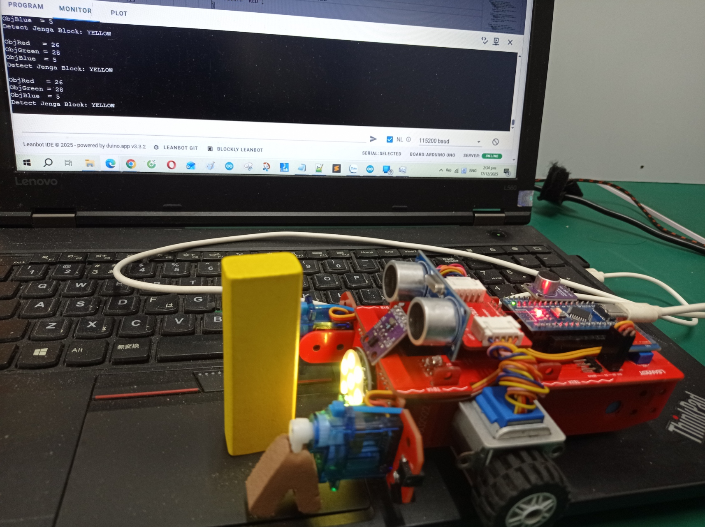
</p>

**Leanbot thực hiện những gì:**
- Leanbot liên tục nhấp nháy LED RGB và phân tích màu vật thể theo chu kỳ 3 giây.
- Sau khi nhận diện được màu, LED hiển thị màu đó và giữ nguyên cho đến chu kỳ đo tiếp theo.
- Màu được nhận diện được:
  + In lên Serial Monitor (giá trị RGB và tên màu).
  + Hiển thị trên LED RGB của Leanbot.

#### Ví dụ đầu ra

Các phép thử sau minh họa cách Leanbot phát hiện màu vật thể bằng hàm `classifyColor()` do AI tạo ra từ mô hình cây quyết định đã huấn luyện.

##### Khối Jenga màu đỏ

<p style="text-align: center;">  
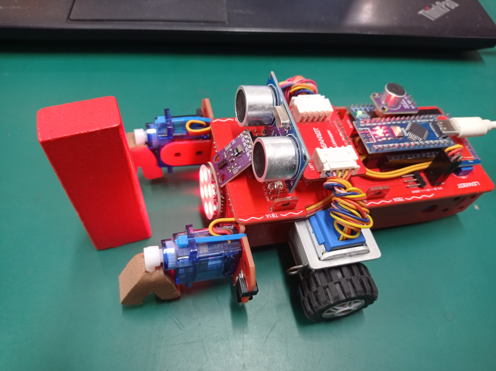
</p>


- Đầu ra Serial:

```

ObjRed   = 19
ObjGreen = 1
ObjBlue  = 2
Detect Jenga Block: RED

ObjRed   = 19
ObjGreen = 2
ObjBlue  = 2
Detect Jenga Block: RED

ObjRed   = 19
ObjGreen = 2
ObjBlue  = 2
Detect Jenga Block: RED

```

##### Khối Jenga màu xanh lá

<p style="text-align: center;">  
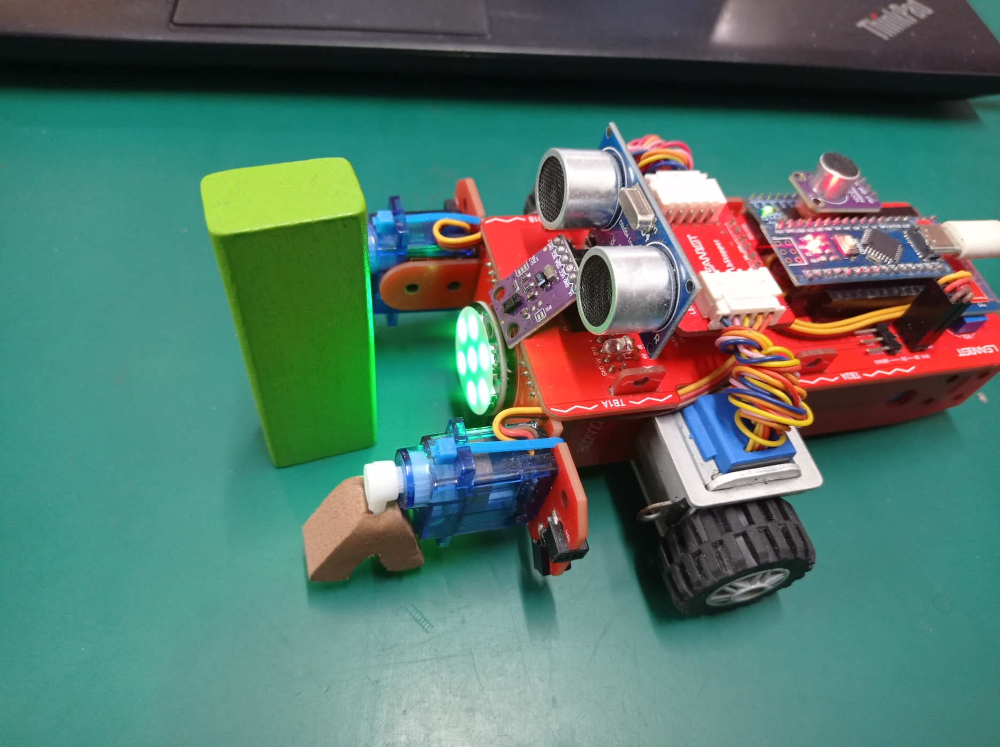
</p>


- Đầu ra Serial:

```

ObjRed   = 6
ObjGreen = 23
ObjBlue  = 5
Detect Jenga Block: GREEN

ObjRed   = 6
ObjGreen = 23
ObjBlue  = 5
Detect Jenga Block: GREEN

ObjRed   = 6
ObjGreen = 23
ObjBlue  = 5
Detect Jenga Block: GREEN

```

##### Khối Jenga màu xanh dương

<p style="text-align: center;">  
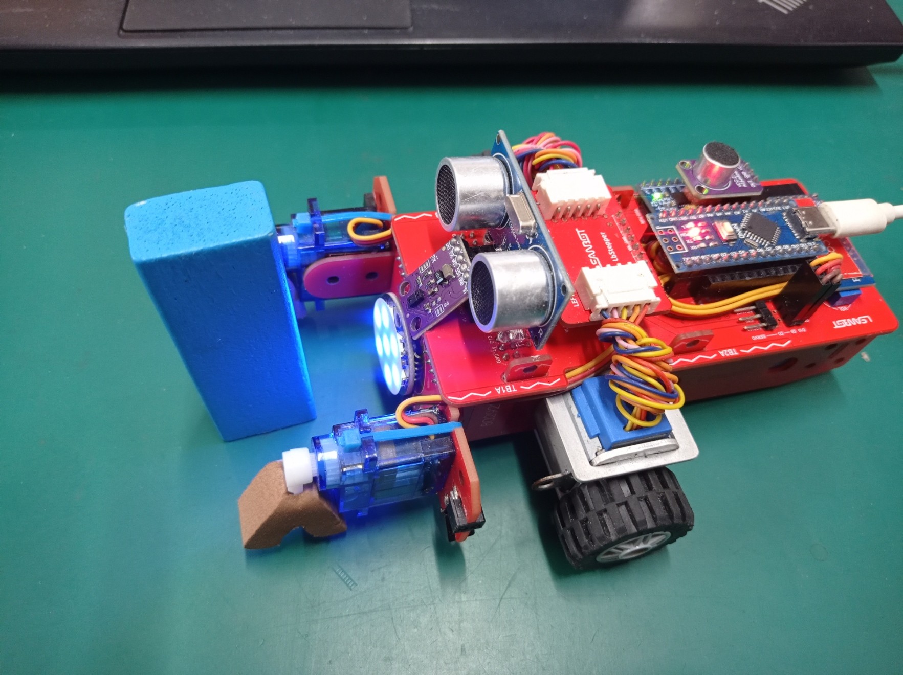
</p>


- Đầu ra Serial:

```

ObjRed   = 2
ObjGreen = 14
ObjBlue  = 31
Detect Jenga Block: BLUE

ObjRed   = 2
ObjGreen = 14
ObjBlue  = 31
Detect Jenga Block: BLUE

ObjRed   = 2
ObjGreen = 15
ObjBlue  = 31
Detect Jenga Block: BLUE

```

##### Khối Jenga màu vàng

<p style="text-align: center;">  
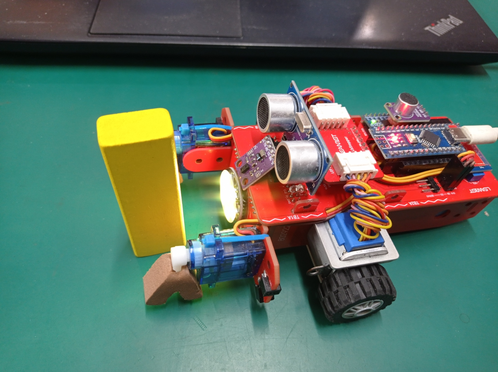
</p>


- Đầu ra Serial:

```

ObjRed   = 24
ObjGreen = 27
ObjBlue  = 5
Detect Jenga Block: YELLOW

ObjRed   = 24
ObjGreen = 27
ObjBlue  = 5
Detect Jenga Block: YELLOW

ObjRed   = 24
ObjGreen = 27
ObjBlue  = 5
Detect Jenga Block: YELLOW

```

##### Khối Jenga màu tím

<p style="text-align: center;">  
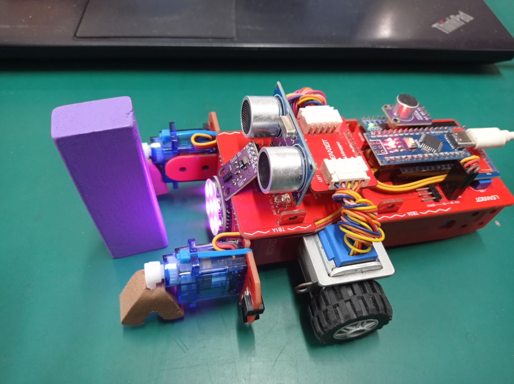
</p>


- Đầu ra Serial:

```

ObjRed   = 4
ObjGreen = 5
ObjBlue  = 26
Detect Jenga Block: PURPLE

ObjRed   = 5
ObjGreen = 6
ObjBlue  = 26
Detect Jenga Block: PURPLE

ObjRed   = 4
ObjGreen = 6
ObjBlue  = 26
Detect Jenga Block: PURPLE

```

##### Khối Jenga màu xanh dương (bị phân loại nhầm thành màu tím)

<p style="text-align: center;">  
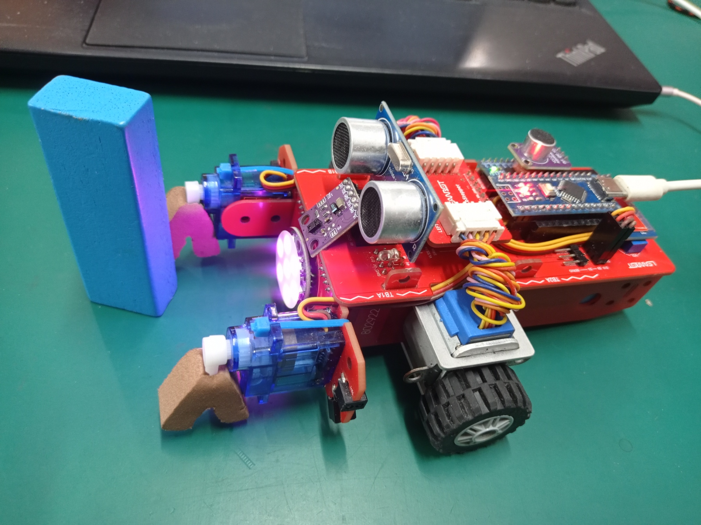
</p>

Mô tả:
- Trong ví dụ này, một khối Jenga màu xanh dương được đặt trước Leanbot, nhưng mô hình dự đoán sai thành màu PURPLE.

Việc phân loại nhầm này có thể xuất phát từ một trong các nguyên nhân sau:
- Khối Jenga nằm quá xa và lệch tâm, khiến tín hiệu đo yếu.
- Mô hình phân loại chưa được tinh chỉnh đủ tốt. Sinh viên được khuyến khích tìm hiểu những cách cải thiện mô hình của mình:
  + Đa dạng hóa dữ liệu huấn luyện,
  + Điều chỉnh các tham số huấn luyện mô hình,
  + Thử các loại mô hình khác ngoài cây quyết định, chẳng hạn Random Forest, Multi-Layer Perceptron, v.v.

- Đầu ra Serial:

```

ObjRed   = 1
ObjGreen = 5
ObjBlue  = 12
Detect Jenga Block: PURPLE

ObjRed   = 1
ObjGreen = 4
ObjBlue  = 12
Detect Jenga Block: PURPLE

ObjRed   = 1
ObjGreen = 5
ObjBlue  = 12
Detect Jenga Block: PURPLE

```
